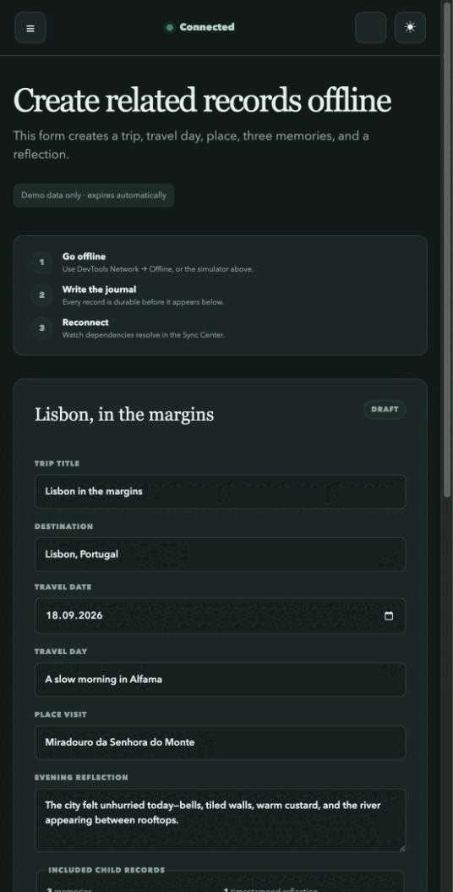

# NgRx Offline

Durable, optimistic, offline mutation handling for Angular applications that
use NgRx.

[Live Atlas Journal showcase](https://poodlelab.github.io/ngrx-offline/) ·
[Documentation](./docs/guides/README.md) ·
[npm package](https://www.npmjs.com/package/@poodlelab/ngrx-offline/v/0.1.0-alpha.1)

> [!IMPORTANT]
> **Alpha status.** NgRx Offline is ready for evaluation, but it is not yet
> recommended for production use. Public APIs may change before 1.0. If it
> solves a problem in your application, please share your use case, missing
> requirements, or API feedback on GitHub. Continued development toward a
> stable release will be guided by real-world use and contributor interest.

Most offline support stops at caching screens or retrying one request. Real
applications also need to create related records before server IDs exist. NgRx
Offline stores those mutations durably, resolves local references as server IDs
become available, and replays them in dependency order. Application code still
uses the normal NgRx workflow: dispatch actions, handle typed lifecycle actions
in reducers or effects, and read state through selectors. The important timing
rule is that optimistic updates begin with `queued`, after IndexedDB commits,
rather than with the initial `requested` action.

NgRx Offline is a mutation outbox, not an offline database and not whole-Store
persistence. Application reducers remain responsible for domain state and
server reconciliation.

The defining guarantee is that an operation is durable before its `queued`
event is emitted.



The showcase creates seven related records while offline, then replays them in
dependency order and replaces each local reference with its server ID.

## Project status

- Architecture: implemented and documented
- Repository foundation: complete
- Domain and reference API contract: complete
- Deterministic core runtime and testing utilities: complete
- IndexedDB persistence and foreground Angular/NgRx integration: complete
- Relations, multi-tab hardening, and worker replay: complete
- Browser and package validation: complete
- Isolated Cloudflare Worker/D1 reference API: deployed for the live showcase
- npm package: [`@poodlelab/ngrx-offline@0.1.0-alpha.1`](https://www.npmjs.com/package/@poodlelab/ngrx-offline/v/0.1.0-alpha.1)
- Atlas Journal showcase: [live on GitHub Pages](https://poodlelab.github.io/ngrx-offline/)

See the [technical concept](./CONCEPT.md) and the
[documentation](./docs/guides/README.md).

The framework-independent API and test harness are introduced in the
[core engine guide](./docs/guides/core-engine.md).
The browser-usable alpha is covered by the
[Angular integration guide](./docs/guides/angular-integration.md).
The relational replay model and reference service are covered by the
[relations guide](./docs/guides/relations-scopes-and-tabs.md) and
[reference API guide](./docs/guides/reference-api.md).
The complete interactive workflow is documented in the
[Atlas Journal showcase guide](./docs/guides/showcase.md).
Optional background execution and its authentication boundaries are covered by
the [service-worker guide](./docs/guides/service-worker-execution.md).
The browser matrix, API maturity, artifact checks, and performance budgets are
recorded in the [quality and compatibility guide](./docs/guides/quality-and-compatibility.md).

## Package

```bash
npm install @poodlelab/ngrx-offline@alpha
```

With pnpm, use `pnpm add @poodlelab/ngrx-offline@alpha`.

Implemented entry points:

```text
@poodlelab/ngrx-offline
@poodlelab/ngrx-offline/core
@poodlelab/ngrx-offline/indexeddb
@poodlelab/ngrx-offline/worker
@poodlelab/ngrx-offline/testing
```

## The small path

Define what should be sent. Entity IDs, dependencies, version 1, durable
ordering, retries, and ID reconciliation use safe defaults:

```ts
import { createOfflineMutation, defineOfflineCreate, offlineRef } from '@poodlelab/ngrx-offline';

const createTravelDay = defineOfflineCreate<CreateTravelDay, CreatedEntity>({
  kind: 'journal.travel-day.create',
  entity: 'travel-day',
  request: (input, { resolve }) => ({
    method: 'POST',
    url: '/api/travel-days',
    body: {
      clientId: input.clientId,
      tripId: resolve(input.trip),
      title: input.title,
    },
  }),
});

export const travelDayMutation = createOfflineMutation(createTravelDay);

store.dispatch(
  travelDayMutation.requested({
    input: {
      clientId: crypto.randomUUID(),
      trip: offlineRef('trip', localTripId),
      title: 'A slow morning in Alfama',
    },
  }),
);
```

`defineOfflineCreate` finds tagged references in the input and derives the
`clientId` to server `id` mapping. The lower-level `defineOfflineOperation`
remains available for non-create operations and custom metadata.

The package targets the latest stable, mutually compatible Angular and NgRx
release line. See [ADR-0002](./docs/decisions/0002-compatibility-and-browser-support.md)
for the compatibility policy.

## AI-assisted development

This project is developed with substantial assistance from agentic AI tools,
currently primarily OpenAI Codex. AI agents are used for implementation,
testing, documentation, and repository maintenance under maintainer direction.

Changes are accepted only after automated validation and maintainer approval.
Responsibility for the project, its design decisions, and its releases remains
with the human maintainer. AI assistance does not change the project's license
or the quality requirements applied to contributions.

## Development

Prerequisites:

- Node.js 22.12 or newer within the Node 22 release line
- pnpm 10.34.5 through Corepack

```bash
corepack enable
pnpm install --frozen-lockfile
pnpm check
```

Useful commands:

```bash
pnpm build           # Build the Angular package and secondary entry points
pnpm start           # Run the local Atlas Journal showcase
pnpm test            # Run unit tests once
pnpm lint            # Lint TypeScript, templates, and Markdown
pnpm format:check    # Check repository formatting
pnpm api:check       # Verify committed public API reports
pnpm package:verify  # Validate and consume the packed npm tarball
```

See [CONTRIBUTING.md](./CONTRIBUTING.md) for the development workflow.

## License

MIT
