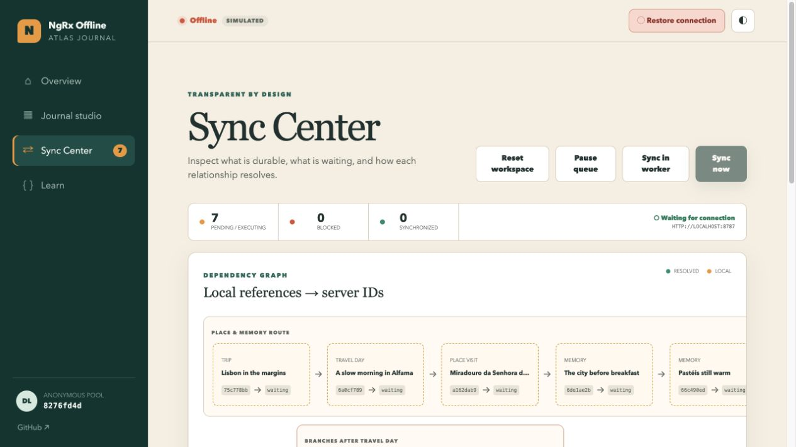

# Atlas Journal showcase

The Angular Atlas Journal is executable documentation for the complete foreground
outbox. It uses a connected travel story because a single-record todo list cannot
demonstrate offline references, dependency ordering, ID reconciliation, or
domain conflicts.

## Reviewed interface captures





## Run it locally

Install the workspace dependencies, migrate and start the local API, then start
Angular in another terminal:

```bash
pnpm install
pnpm api:migrate:local
pnpm api:dev
pnpm start
```

Open `http://localhost:4200`. Local Angular origins are already allowed by the
reference API. The application creates a random anonymous workspace capability;
never enter personal, confidential, or production data.

## Complete the offline walkthrough

1. Open **Journal studio** while online so the application shell is loaded.
2. In browser DevTools, choose **Network → Offline**. The in-app simulator is a
   convenient alternative for repeated demonstrations.
3. Save the prefilled travel day. The app persists a Trip, Travel Day, Place
   Visit, three Memories, and a Day Reflection. Each child contains an explicit
   reference to its locally identified parent.
4. Open **Sync Center**. All seven operations are durable, parent server IDs are
   visibly unresolved, and the records already appear in the optimistic domain
   projection.
5. Restore the connection. One scoped executor sends the chain in dependency
   order. The reference API assigns numeric IDs and atomically stores each
   idempotency result.
6. Watch every local UUID map to a numeric server ID and the durable queue drain.

Reloading while offline restores the pending operations and optimistic entities
from IndexedDB. In the production build, **Sync in worker** hands the queue to
the custom service worker. The page can then close; reopening consumes durable
receipts and displays every reconciled server ID.

## Failure and conflict laboratory

The Sync Center can arm the next operation for a deterministic timeout,
commit-with-lost-response, `409`, `412`, `422`, or `500`. The control is scoped
to the anonymous workspace and one idempotency key. A permanent conflict enters
the blocked state, where **Resolve & retry**, **Cancel**, and **Discard** make the
application's policy explicit.

The lost-response mode commits the domain mutation and idempotency receipt, then
suppresses the first success response. Retrying uses the same operation key and
receives the original result, proving that two deliveries remain one logical
mutation.

## Source map

- Worker-safe operation definitions and relationships:
  [`apps/showcase/src/app/operation-definitions.ts`](../../apps/showcase/src/app/operation-definitions.ts)
- NgRx mutation bindings:
  [`apps/showcase/src/app/offline-definitions.ts`](../../apps/showcase/src/app/offline-definitions.ts)
- NgRx optimistic state and reconciliation:
  [`apps/showcase/src/app/showcase.store.ts`](../../apps/showcase/src/app/showcase.store.ts)
- Scoped reference-API transport:
  [`apps/showcase/src/app/showcase.transport.ts`](../../apps/showcase/src/app/showcase.transport.ts)
- Angular provider configuration:
  [`apps/showcase/src/main.ts`](../../apps/showcase/src/main.ts)
- Production PWA caching:
  [`apps/showcase/ngsw-config.json`](../../apps/showcase/ngsw-config.json)
- Custom outbox worker:
  [`apps/showcase/src/offline-service-worker.ts`](../../apps/showcase/src/offline-service-worker.ts)

The app places smaller copyable versions of these patterns beside the live
behavior in its **Learn** section.

## Deployment readiness

`pnpm build:showcase` creates a production build with `/ngrx-offline/` as its
GitHub Pages base path. The build includes an Angular application-shell worker
extended with the optional outbox executor, a web manifest, repository-scoped
service-worker URLs, and a `404.html` fallback for Pages navigation. Publishing
remains a separate owner-controlled release step.

The production API base can be supplied before the main bundle runs:

```html
<script>
  window.__NGRX_OFFLINE_CONFIG__ = {
    apiBaseUrl: 'https://ngrx-offline-demo-api.poodlelab.workers.dev',
  };
</script>
```

The API must implement the documented idempotency contract. A client retry key
is not sufficient unless the server stores the first committed status, body,
location, and ETag atomically with the mutation.
